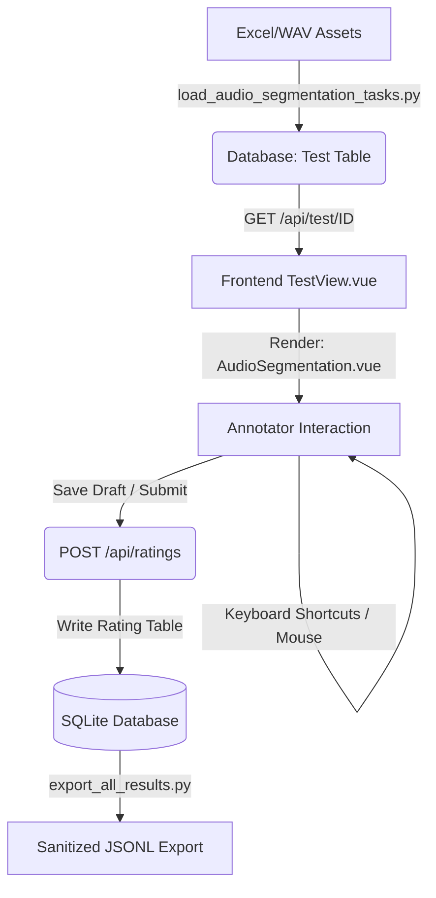

# Audio Segmentation Task Pipeline Guide

This guide explains the backend loader pipeline, server serving logic, frontend user interface, keyboard shortcuts, database storage, and export logic for the **Audio Segmentation** (`audio-segmentation`) task type.

---

## 1. Pipeline Overview

The `audio-segmentation` task type allows annotators to review segment audio recordings, edit or correct transcripts, and select an **Accept** or **Reject** decision. If rejected, annotators select from a checklist of 31 specific reasons (and optionally enter a custom reason).



---

## 2. Loader Pipeline (`backend/load_audio_segmentation_tasks.py`)

The loader script processes the assets in the `/root/saffron/backend/audio_segmentation` directory:
- Reads `English_Calm_Explainer_Set0.xlsx` via pandas to retrieve original transcripts and speakers.
- Scans files for `.wav` recordings, mapping them back to matching rows via the `ID` column.
- Automatically determines language and teacher persona based on the excel filename schema (e.g. `English_Calm_Explainer_Set0` -> Language: `English`, Persona: `Calm Explainer`).
- Saves all processed records as a JSON list (`json_entry`) inside a new `Test` row in the database, setting `test_type = 'audio-segmentation'`.

**To load tasks:**
```bash
backend/venv/bin/python backend/load_audio_segmentation_tasks.py
```

**Preferred one-command loader (`backend/load_audio_set.py`):** downloads the
recordings + Excel from Drive, normalises names, validates, and calls this
loader for you.

- Two-source: `$PY load_audio_set.py --audio-link "<recordings folder>" --persona storyteller --excel-set 2`
  (downloads only the `EXPORTED ID` WAVs via curl, renames `Conv_10_T_1_En.wav`
  -> `En_Conv_10_T_1.wav`, pulls `<Lang>_<Persona>_Set<n>.xlsx` from the shared
  Excel folder). Each set has its own audio folder.
- Single-folder: `$PY load_audio_set.py --link "<folder with WAVs+Excel>"`
- From laptop: `C:\Users\Avnish\saffron_audio.ps1 -AudioLink "<...>" -Persona storyteller -ExcelSet 2`

---

## 3. Serving Audio Files

Since files are stored locally in the backend workspace, the server provides a dedicated endpoint in `views.py` supporting range requests for streamable playbacks:
- **Endpoint**: `GET /api/audio/<path:filename>`
- Serves files directly from `backend/audio_segmentation/` using Flask's `send_from_directory` to natively handle partial range requests (required for progress scrubbing/seeking in HTML5 `<audio>`).

---

## 4. Frontend Component (`frontend/src/components/AudioSegmentation.vue`)

When an `audio-segmentation` test is loaded, `TestView.vue` or `DynamicTestView.vue` resolves the component mapping to load `AudioSegmentation.vue`.

### Visual Features
- **Metadata Cards**: Displays Speaker, Role, Language, and Persona clearly at the top.
- **Custom Audio Player**: A styled, interactive track player featuring:
  - Play/Pause toggle with large central button.
  - Interactive timeline slider showing `Current Time / Total Duration`.
  - Playback speed rate controller (`0.5x`, `0.75x`, `1.0x`, `1.25x`, `1.5x`, `2.0x`).
  - Volume slider and mute button.
- **Transcript Textarea**: Editable box allowing raters to rewrite/edit the text with auto-height adjustment.
- **Evaluation Decisions**:
  - **Accept**: Accept the transcript/segment as correct.
  - **Reject**: Triggers a checklist modal to select from 30 predefined reasons. If `others` is checked, a custom reason text input is revealed.

### Keyboard Shortcuts
- <kbd>Space</kbd> - Play / Pause the audio player (ignored when typing in textareas).
- <kbd>1</kbd> - Select Accept.
- <kbd>2</kbd> - Select Reject (reveals reasons modal).
- <kbd>Ctrl</kbd>/<kbd>⌘</kbd> + <kbd>S</kbd> - Save draft progress.
- <kbd>Ctrl</kbd>/<kbd>⌘</kbd> + <kbd>Enter</kbd> - Submit task and proceed.

---

## 5. Database Schema & Data Merging

The task preserves existing data layouts to guarantee that existing tests and raters are **unaffected**:
- All rating results are stored inside the `Rating` table using the existing `results_json` field.
- **Merge Logic**: When the task is fetched via `/api/test/<test_id>` or Prolific endpoints, the server retrieves latest `Rating` rows and merges `transcript`, `rejection_reasons`, and `custom_rejection_reason` back into the original test items so annotators can resume work without loss.

---

## 6. Clean Exporter (`backend/export_jsonl.py`)

Annotations can be exported cleanly using the bulk exporter script:
- Maps `audio-segmentation` tests to `export_ratings_to_jsonl`.
- Sanitizes keys, exports rating annotations alongside original fields, and preserves completed rating edits.
- Output file format consists of JSON Lines (one JSON dictionary per line) saved in the `/root/saffron/backend/exports` folder.

**To run the bulk export:**
```bash
backend/venv/bin/python backend/export_all_results.py
```

---

## Admin dashboard: audio hours (added 2026-07-08)

The admin dashboard (Tracking page, Overview tab) has an **Audio Segmentation
Hours** section: one card per audio-segmentation batch showing the total audio
duration of the batch (summed from the WAV headers under
`backend/audio_segmentation/<set>/`, cached per file), the completed duration
with a progress bar, and a per-annotator table (tasks done + audio hours
completed, counted over distinct submitted task ids). Data comes from the
`audio_segmentation` key of `GET /api/admin/dashboard` (see
`get_admin_dashboard` in `backend/application/views.py`). After backend edits:
`kill -HUP <gunicorn master pid>`; after frontend edits: `npm run build` in
`frontend/`.
